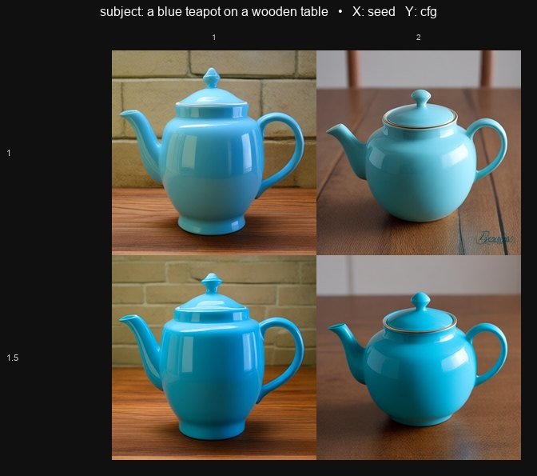
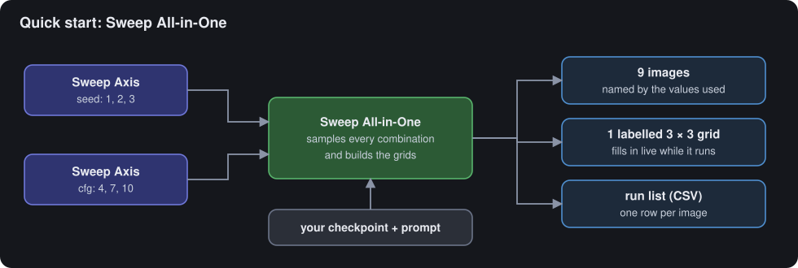
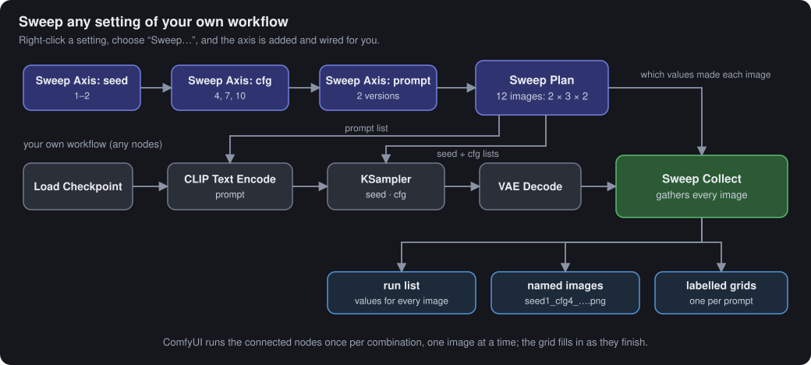
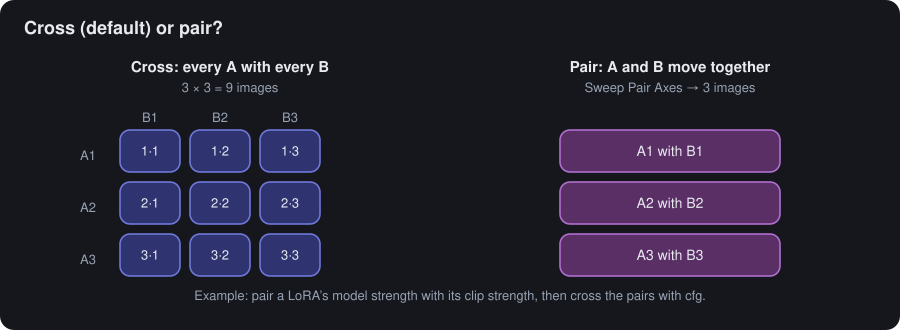
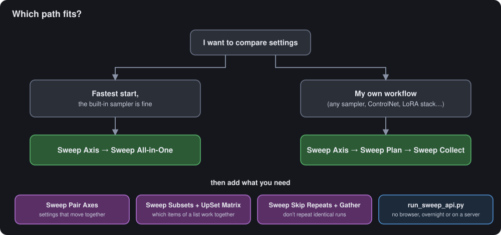

# SweepKit for ComfyUI

**Try every combination of your settings, from one Run.** Pick what to vary (seeds, cfg, prompts,
LoRA strengths, samplers, models), and SweepKit makes every combination. It saves each image under a
name made from the values used, builds labelled grids, and writes a run list you can open in a
spreadsheet.

For ComfyUI users who want to compare settings side by side. New here? [Install](#install) it, then
follow the [Quick start](#quick-start) below (about 5 minutes).

<p align="center">
  
  <br><sub>One grid out of a sweep: seed across, cfg down. The prompt is on the title line. (SweepKit 1.1, generated 2026-11)</sub>
</p>

## What can I do with it?

| I want to know... | Sweep this | You get |
|---|---|---|
| Which **cfg or steps** looks best | `cfg` 4, 7, 10 × `steps` 15, 25, 35 | one grid, every pairing |
| How strong my **LoRA** should be | LoRA strength 0.2 … 1.0 (model and clip paired) | a row per strength |
| Which **sampler or checkpoint** suits a prompt | tick them from the list | one image each, same seed |
| How **prompt wording** changes the result | several prompt versions | one grid per prompt |
| Which **styles work together** | every pair and triple of a list | a chart of which styles each image uses |

## How it works

You list the values to try for each setting: each setting with its values is an **axis**. SweepKit
makes every combination of the axes' values and runs one image for each.

<p align="center"></p>

- **How many images:** the counts multiply. Seed 1–3 × cfg 4, 7, 10 × 2 prompts = 3 × 3 × 2 = 18 images.
- **How many grids:** two axes form each grid (columns and rows). Every value of any further axis makes
  another grid; by default a text axis, such as the prompt, is the one that splits. So those 18 images
  come out as 2 grids of 3 × 3.
- **How long it takes:** counts grow fast. 3 axes of 10 values each are 1,000 images. On a mid-range
  laptop GPU at 25 steps, one 1024 × 1024 image can take over a minute, so 1,000 images could take
  about a day. Small 512 × 512 images, like the quick start's, take seconds each. Your times depend
  on your GPU and model.
- **Check the count on the node before you press Run.** Every axis shows *"3 values: 1 · 2 · 3"*, and
  Sweep All-in-One or Sweep Plan shows *"18 images: 3 × 3 × 2"*.
- **How to stop:** cancel the run in ComfyUI's queue. Images already saved are kept.

**Use your own workflow?** Right-click any number, choice or text setting on any node (for a prompt
box, right-click the node's title bar) and choose **Sweep "…"**. SweepKit adds the axis and connects it.
Your nodes (any sampler, ControlNet, LoRA stack…) stay yours.

<p align="center"></p>

The blue nodes say what to vary; the green node makes or collects the images.

### Words used here

| Word | Meaning |
|---|---|
| **axis** | One setting to vary, with the list of values to try. |
| **Sweep Plan** | The node that turns your axes into the list of combinations. |
| **Sweep Collect** | The node that receives every image, saves it, and builds the grids. |
| **run list** | A spreadsheet file listing each image, its file name and its values. |
| **live grid** | The grid shown on the node, filling in as each image finishes. |
| **template browser** | ComfyUI's list of ready-made workflows, opened from ComfyUI's main menu. |

## Two ways to start

| | **Sweep All-in-One** | **Sweep Plan + Sweep Collect** |
|---|---|---|
| Good for | the fastest start; a standard text-to-image sweep | your existing workflow, any nodes |
| Nodes to add | the axes + 1 | the axes + 2 (the right-click menu adds them) |
| Live grid | yes, on the node while it runs | yes, on Sweep Collect as each image finishes (started from the browser, Sweep Plan's *live grid* on) |
| Extra node packs | none | none |
| Example | `1_quickstart_all_in_one.json` | `2_sweep_any_setting.json` |

Change only grid settings (which axis goes across, cell size…) and queue again: the grids are rebuilt
without making new images.

## Install

### Requirements

- ComfyUI (tested with 0.31.0, frontend 1.48.7). Nothing else to install: SweepKit only uses what
  ComfyUI already includes.
- Only examples 4–6 (styles that work together, skipping repeats, a list of models) need the
  [ComfyUI-List-Utils](https://github.com/godmt/ComfyUI-List-Utils) node pack. Install it the same
  way as SweepKit.

### Steps

1. In ComfyUI, open **Manager → Custom Nodes Manager**, search for *SweepKit*, and click **Install**.
2. Restart ComfyUI, then reload the browser page.

**If you use a terminal (optional):** go to ComfyUI's `custom_nodes` folder (in the Windows portable
build: `ComfyUI_windows_portable\ComfyUI\custom_nodes`) and run:

```bash
git clone https://github.com/bi-toru-to/ComfyUI-SweepKit ComfyUI-SweepKit
```

Then restart ComfyUI and reload the browser page.

## Quick start

1. In ComfyUI, open the main menu (the ComfyUI logo, top left) and choose **Browse Templates**.
2. Under **Extensions**, choose **ComfyUI-SweepKit**, then **1_quickstart_all_in_one**. You can
   also drag `1_quickstart_all_in_one.json` onto the canvas from the `example_workflows` folder inside
   the installed SweepKit folder (`ComfyUI\custom_nodes\ComfyUI-SweepKit`).
3. In **Load Checkpoint**, pick your checkpoint.
4. Press **Run**. The grid fills in on the Sweep All-in-One node.
5. Open ComfyUI's `output` folder (in the Windows portable build:
   `ComfyUI_windows_portable\ComfyUI\output`), then `SweepKit_quickstart`. It holds 9 images named by
   their values, a 3 × 3 grid in `_grids`, and a run list (`sweep_manifest_00001.csv`) you can open
   in a spreadsheet.

Next: change an axis's values, or right-click any setting in your own workflow and choose
**Sweep "…"**. Then right-click your **VAE Decode** and choose **Sweep: collect results here**.
How to type values (lists, ranges, LoRA strengths): see
[Typing values](NODE_GUIDE.md#typing-values).

## Beyond a plain grid

<p align="center"></p>

- **Pair settings:** Sweep Pair Axes moves two axes together, value by value (a LoRA's model strength
  with its clip strength). Example: `3_pair_lora_strengths.json`.
- **Try subsets of a list:** Sweep Subsets of a List makes every single item, pair, triple and so on
  of a list. Sweep UpSet Matrix draws them as a chart: one column per subset, with dots marking the
  items it uses. Example: `4_style_combinations_upset.json`.
- **Skip repeats:** when some combinations would make the same image, Sweep Skip Repeats makes each
  different image once, and Sweep Gather puts the images back in every place. Example:
  `5_dedupe_gather.json`.
- **Pick from a list:** for a choice setting (sampler, LoRA, checkpoint), right-click the axis and choose
  **Pick values from the list…** to tick what to compare.

## Run it without the browser

SweepKit does its looping inside ComfyUI, so one request makes every image: no browser tab needs to
stay open. In ComfyUI, open the main menu and choose **File → Export (API)**: this saves your workflow
as a file that scripts can send to ComfyUI. Then run:

```bash
python scripts/run_sweep_api.py workflow_api.json --server http://127.0.0.1:8188 --set 12.values="1-8"
```

- `workflow_api.json` is the file you exported.
- `http://127.0.0.1:8188` is the address of your ComfyUI (the one in your browser's address bar).
- `12` is the number of the node to change. To see node numbers, open ComfyUI's **Settings**, find
  **Node ID badge mode** and set it to **Show all**.
- `values` is the input to change on that node, and `"1-8"` its new value. Leave out `--set` to run
  the workflow as saved.

This suits overnight runs and servers.

## SweepKit and quick XY-plot nodes

Quick XY-plot nodes (for example [XY Plot Pixaroma](https://workflows.pixaroma.com/help/nodes/xy-plot/))
are great for a fast two-setting comparison. SweepKit is for when the question is bigger. The
comparison below is based on that node's public documentation.

| | Quick XY-plot nodes | SweepKit |
|---|---|---|
| Settings varied | two (X and Y) | any number; extra axes become extra grids |
| Pairing, subsets, skipping repeats | no | yes |
| How the run is driven | the browser tab queues each cell | ComfyUI does it, so scripts and unattended runs work |
| Live grid | yes, cell by cell | yes, image by image, in the browser; from a script it runs in one go |
| Files | the grid, optionally each cell | every image named by its values, the grids, and a run list |
| The sweep in your workflow | inside one node | visible as axis nodes you can read, copy and share |

## Documentation

- **[NODE_GUIDE.md](NODE_GUIDE.md):** every node, input and output, plus step-by-step versions of the example workflows.
- **[DESIGN.md](DESIGN.md):** for contributors: why the pack is built this way, and the history of notable bugs.
- **[CHANGELOG.md](CHANGELOG.md):** what changed between versions.

<p align="center"></p>

## Development

```bash
python tests/run_all.py     # all Python and JS test suites (needs numpy, Pillow, node)
ruff check . && ruff format --check .
python scripts/make_diagrams.py   # redraw docs/img/*.svg
```

The tests run without ComfyUI or torch: `tests/stubs/build_stubs.py` provides lightweight stand-ins.

## License

[MIT](LICENSE)

---

This guide covers SweepKit 1.1.0, last checked 2026-11-10.

Problems or questions? Open an issue on [GitHub](https://github.com/bi-toru-to/ComfyUI-SweepKit/issues).
